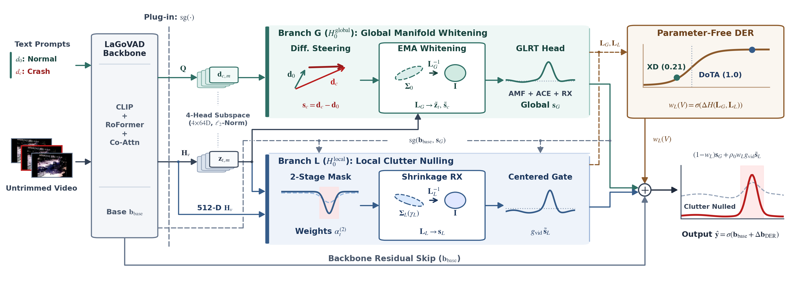
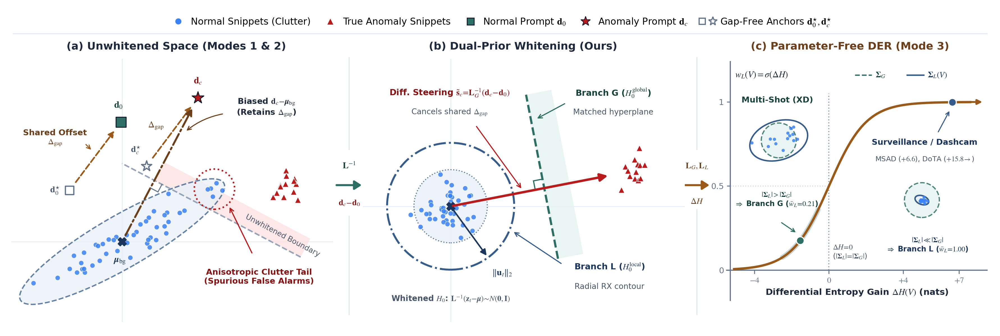

<div align="center">

# Dual-Prior Semantic Beamforming: Parameter-Free Differential-Entropy Routing for Open-World Video Anomaly Detection

<p align="center">
  <b>Shilong Du</b><sup>1</sup>, <b>Shifeng Li</b><sup>1,*</sup>, <b>Drukdron Tsomo</b><sup>2</sup>, <b>Zhenshuo Chen</b><sup>1</sup>, and <b>Yuhang Xie</b><sup>1</sup><br>
  <sup>1</sup>Bohai University &nbsp;&nbsp;&middot;&nbsp;&nbsp; <sup>2</sup>Minzu University of China &nbsp;&nbsp;&middot;&nbsp;&nbsp; <sup>*</sup>Corresponding Author
</p>

<p align="center">
  <a href="https://pytorch.org/"></a>
  <a href="./LICENSE"></a>
  <a href="#-model-zoo--pretrained-weights"></a>
  <a href="https://huggingface.co/datasets/Kamino123/PreVAD"></a>
  <a href="https://github.com/Kamino666/LaGoVAD-PreVAD"></a>
</p>

<p align="center">
  <a href="#-highlights">Highlights</a> •
  <a href="#-environment-setup">Setup</a> •
  <a href="#-model-zoo--pretrained-weights">Model Zoo</a> •
  <a href="#-dataset-preparation">Datasets</a> •
  <a href="#-training--evaluation">Usage</a> •
  <a href="#-main-results">Results</a> •
  <a href="#-citation">Citation</a>
</p>

</div>

---

Official PyTorch implementation of **DP-SB + DER** (*Dual-Prior Semantic Beamformer with Parameter-Free Differential-Entropy Routing*) for open-world weakly supervised video anomaly detection (WS-VAD) under cross-camera domain shift and inference-time definition drift.

<p align="center">
  
  <br>
  <em><b>Architecture Overview (Paper Fig. 2).</b> Attaching to a language-guided VAD backbone with +330K trainable parameters (+1.74%; +0 extra for DER), DP-SB couples a Global Manifold Branch (H<sub>0</sub><sup>global</sup>) and a Local Clutter-Nulling Branch (H<sub>0</sub><sup>local</sup>) in M=4 &ell;<sub>2</sub>-normalized subspaces (d<sub>h</sub>=64), routed per video via parameter-free Cholesky differential-entropy gain w<sub>L</sub>(V)=&sigma;(&Delta;H(V)) (with global weight w<sub>G</sub>=1&minus;w<sub>L</sub>).</em>
</p>

---

## 🔥 Highlights

- **Adaptive Array Clutter Suppression for Open-World VAD:** Reformulates language-guided frame scoring via Cholesky covariance whitening across $M = 4$ subspaces ($d_h = 64$), pairing a **Global Manifold Branch** (EMA normal prior + intra-modal differential text steering $\mathbf{s}_{c,m} = \mathbf{d}_{c,m} - \mathbf{d}_{0,m}$ that identically cancels class-invariant additive cross-modal modality-gap offsets) with a **Local Clutter-Nulling Branch** (two-stage IR-MVDR masking + bounded empirical-Bayes shrinkage $\gamma_L \in [0.75, 0.92]$ + sign-safe chunk centering + video confidence gating $g_{\mathrm{vid}} \in [0.15, 1.0]$).
- **Parameter-Free Differential-Entropy Routing (DER):** Reuses the Cholesky diagonals $(\mathbf{L}_{G,m}, \mathbf{L}_{L,m}(V))$ already computed by both branches with **zero extra parameters** and **+0.004 ms/clip** batched overhead, computing exact per-video Gaussian differential entropy gain $\Delta H(V)$ at the theoretical volume-equilibrium point ($c_0 = 0, \tau_{\mathrm{der}} = 1.0$) with a single PreVAD-train variance-equalization constant ($\rho_0 = 5.0$). Without per-dataset weight tuning or domain labels, DER automatically routes multi-shot streams (XD-Violence: $\bar{w}_L = 0.21$) toward global whitening and structured surveillance/dashcam feeds (MSAD/DoTA: $\bar{w}_L = 1.00$) toward local clutter nulling.
- **Strong Cross-Domain, Zero-Leakage, and Definition-Drift Performance:**
  - **Protocol 1 (8 Benchmarks, No Per-Dataset Weight Tuning):** Default Plug-in DP-SB + DER reaches **77.97%** 7-zero-shot mean and **77.22%** 8-dataset mean (**+1.61%** over published LaGoVAD, **+0.94%** over reproduced LaGoVAD, **+0.78%** over the best constant mixing ratio), with **+4.13%** on ego-motion dashcams (**DoTA 66.73%**).
  - **Strict Zero-Leakage Single-Checkpoint Audit (PreVAD-Best):** Plug-in DP-SB + DER (epoch 8) achieves **75.52% 7-ZS / 75.08% 8-DS** (**+1.73% / +1.66%** over reproduced LaGoVAD at epoch 26, winning 7/8 datasets, and **+0.48%** over the released official model at epoch 11).
  - **Protocol 2 (`drift@5` Open-World Definition Drift):** Achieves **86.83% Mean AUC / 42.00% Mean AP** on the published subsets in Appendix Table D of LaGoVAD (outperforming 7B MLLMs such as Qwen2.5-VL-7B by >20 AP points at **+0.22 ms/clip** batched overhead) and lifts same-video paired exclusion drop $\overline{\Delta}_{\mathrm{flip}}$ on XD-Violence from `−0.0056` to **`+0.0195`** ($p = 2.2 \times 10^{-34}$).

<details>
<summary><b>📐 Geometric Motivation (Click to expand Paper Fig. 1)</b></summary>
<br>
<p align="center">
  
  <br>
  <em><b>Geometric Motivation (Paper Fig. 1).</b> (a) Unwhitened scoring suffers from anisotropic camera clutter and shared cross-modal offset &Delta;<sub>gap</sub>. (b) Cholesky whitening and differential steering cancel &Delta;<sub>gap</sub> along an orthogonal matched hyperplane (Branch G) and radial Mahalanobis contour (Branch L). (c) Parameter-free DER routes multi-shot and single-camera regimes per clip via w<sub>L</sub>(V)=&sigma;(&Delta;H(V)) without per-dataset weight tuning.</em>
</p>
</details>

---

## 📋 Release Checklist

- [x] Core DP-SB + Parameter-Free DER module (`src/models/LaGoVAD/beamformer.py`)
- [x] Deterministic training configs & runner (Plug-in, End-to-End, Baseline, Ablations)
- [x] Official Protocol 1 (8-benchmark & zero-leakage single-checkpoint), Protocol 2 (`drift@5`), and Operating-Point FPR/FNR & Efficiency scripts
- [x] Self-contained unit & theoretical-property tests verifying Propositions 1–3 (`tests/test_dpsb_der.py`)
- [x] Pretrained checkpoints & evaluation configs ([Quark Drive](#-model-zoo--pretrained-weights))

---

## 🛠️ Environment Setup

Tested with **Python 3.11**, **PyTorch 2.4+ / 2.6** (CUDA 12.4), and **Transformers 4.56**.

```bash
git clone https://github.com/SVIL2024/DP-SB-DER.git
cd DP-SB-DER

python -m venv .venv
source .venv/bin/activate
pip install -r requirements.txt
```

Verify the DP-SB + DER module, parameter count (+330K; +0 for DER), and Propositions 1–3 immediately (zero dataset files required):

```bash
python tests/test_dpsb_der.py
```

---

## 📦 Model Zoo & Pretrained Weights

All trained checkpoints and matched DER evaluation configs reported in the paper are packaged in `dpsb_der_weights.zip` (~3.08 GB, weights-only with frozen CLIP stripped):

| Resource | Download Link | Access / Checksum |
|---|---|---|
| **All Paper Checkpoints (`dpsb_der_weights.zip`)** | [Quark Drive (夸克网盘)](https://pan.quark.cn/s/2c5b6f946429?pwd=wUdg) | Extraction Code / 提取码: **`wUdg`** |
| **SHA-256 Checksum** | `dpsb_der_weights.zip` | `a513f8dd401564fbe6af6d5695004f7c924976671d535426d459f591fd37cdbc` |

Unpack into `ckpts/` at the repository root:

```bash
mkdir -p ckpts
unzip dpsb_der_weights.zip -d ckpts/
```

<details>
<summary><b>Archive Directory Layout & Key Checkpoints (Click to expand)</b></summary>

```text
ckpts/dpsb_der_weights/
├── 1_dpsb_der_plugin_default/              # Default Plug-in DP-SB + DER (Table I, II, III, IV)
│   ├── config_der_ctr_gate.yaml            # Parameter-free DER (c0=0, tau_der=1, rho0=5.0, Centered + Gated)
│   ├── config_der_ctr_nogate.yaml          # Table III / IV(a) ablation: Centered, No Gate
│   ├── config_der_raw_nogate.yaml          # Table III ablation: Uncentered, No Gate
│   ├── dpsb_plugin_ep08_prevad_best.ckpt   # Strict Zero-Leakage PreVAD-Best (75.52% 7-ZS / 75.08% 8-DS)
│   ├── dpsb_plugin_ep40_final.ckpt         # Final Epoch 40 (74.51% 7-ZS / 73.91% 8-DS)
│   └── dpsb_plugin_ep{01,02,04,06,07,19,20}_*.ckpt
├── 2_dpsb_der_end2end/                     # End-to-End DP-SB + DER (Table I, II, IV(b))
│   ├── config_der_ctr_gate.yaml
│   ├── dpsb_e2e_ep26_prevad_best.ckpt      # Strict Zero-Leakage PreVAD-Best (74.98% 7-ZS / 74.66% 8-DS)
│   ├── dpsb_e2e_ep40_final.ckpt            # Final Epoch 40 (74.24% 7-ZS / 73.78% 8-DS)
│   └── dpsb_e2e_ep{01,03,04,07,09,22}_*.ckpt
├── 3_lagovad_reproduced_baseline/          # Reproduced LaGoVAD Baseline (FP32, BS=128)
│   ├── config_baseline.yaml
│   ├── lagovad_repro_ep26_prevad_best.ckpt
│   ├── lagovad_repro_ep40_final.ckpt
│   └── lagovad_repro_ep{02,05,06,07,19,21}_*.ckpt
├── 4_ablations_retrained/                  # Table IV(b) From-Scratch Retraining Ablations
│   ├── no_diff_steering/                   # w/o Differential Steering (d_c - mu_0)
│   └── single_stage_mask/                  # w/o 2-Stage IR-MVDR (1-Stage Mask)
├── 5_lagovad_official_ref/                 # Reference Official Released LaGoVAD Model (epoch 11)
└── WEIGHTS_MANIFEST.md
```

</details>

---

## 📂 Dataset Preparation

Dataset acquisition, annotations, and CLIP ViT-B/16 feature conventions strictly follow **[LaGoVAD / PreVAD (ICLR 2026)](https://github.com/Kamino666/LaGoVAD-PreVAD)**:

1. **PreVAD (Training & In-Domain Validation):**
   Download the official PreVAD annotations and frozen CLIP ViT-B/16 features from:
   - 🤗 Hugging Face: [`Kamino123/PreVAD`](https://huggingface.co/datasets/Kamino123/PreVAD)
   - 🌐 ModelScope: [`Kamino/PreVAD`](https://www.modelscope.cn/datasets/Kamino/PreVAD)
   Place the extracted contents under `data/PreVAD/`.

2. **Seven Zero-Shot Test Benchmarks (XD-Violence, UCF-Crime, MSAD, UBnormal, DoTA, TAD, LAD):**
   - Standard public test split annotations (`*_test_anno.json`) are already included in `data/other_datasets/`. Copy them into `data/PreVAD/other_datasets/` if not already present.
   - Follow [LaGoVAD's Data Preparation guide](https://github.com/Kamino666/LaGoVAD-PreVAD#data-preparation) to obtain the benchmark videos and extract CLIP ViT-B/16 features (sampling stride `interval=8`) using our CLI helper:

```bash
python tools/extract_feat_clip.py \
  --video-dir data/PreVAD/other_datasets/ucf_videos \
  --output-dir data/PreVAD/other_datasets/ucf_features \
  --interval 8 \
  --device cuda:0
```

Expected directory layout:

```text
data/PreVAD/
├── v6/
│   ├── prevad_train_anno_v6.json
│   ├── prevad_test_anno_v6.json
│   └── train_search_cache.json
├── other_datasets/
│   ├── {xd,ucf,msad,ubnormal,dota,tad,lad}_test_anno.json
│   └── {xd,ucf,msad,ubnormal,dota,tad,lad}_features/
└── <PreVAD CLIP ViT-B/16 feature folders>
```

---

## 🚀 Training & Evaluation

### 1. Training from Scratch on PreVAD

All models train strictly from scratch for 40 epochs on a single RTX 3090 Ti (`seed=2024`, FP32, batch size 128, AdamW `lr=5e-5`, `4×` on DP-SB):

```bash
# Default Plug-in DP-SB (stop-gradient decoupled)
python scripts/train.py \
  --config configs/dpsb_plugin_train.yaml \
  --data-root data/PreVAD \
  --out-dir runs/dpsb_plugin

# End-to-End DP-SB
python scripts/train.py \
  --config configs/dpsb_e2e_train.yaml \
  --data-root data/PreVAD \
  --out-dir runs/dpsb_e2e

# Reproduced LaGoVAD Baseline
python scripts/train.py \
  --config configs/baseline_lagovad_train.yaml \
  --data-root data/PreVAD \
  --out-dir runs/baseline_lagovad

# Table IV(b) Retraining Ablations
python scripts/train.py --config configs/ablation_no_diff_steer.yaml --data-root data/PreVAD --out-dir runs/abl_no_diff
python scripts/train.py --config configs/ablation_stage1_mask.yaml   --data-root data/PreVAD --out-dir runs/abl_stage1
```

### 2. Protocol 1: Eight-Benchmark Evaluation & Zero-Leakage Audit (Table I & Table IV)

All Protocol 1 evaluations call the untouched official scripts (`src/full_length_eval.py` and `src/full_length_eval_dota.py`) under one shared parameter-free DER rule ($c_0 = 0, \tau_{\mathrm{der}} = 1.0, \rho_0 = 5.0$, Centered + Gated):

```bash
# Strict Zero-Leakage Single-Checkpoint Audit (Plug-in PreVAD-Best, epoch 8 -> 75.52% 7-ZS / 75.08% 8-DS)
python scripts/eval_protocol1.py \
  --config configs/dpsb_der_eval_plugin.yaml \
  --ckpt ckpts/dpsb_der_weights/1_dpsb_der_plugin_default/dpsb_plugin_ep08_prevad_best.ckpt \
  --data-root data/PreVAD \
  --der \
  --out-dir outputs/zero_leakage_plugin_ep08

# Strict Zero-Leakage Single-Checkpoint Audit (End-to-End PreVAD-Best, epoch 26 -> 74.98% 7-ZS / 74.66% 8-DS)
python scripts/eval_protocol1.py \
  --config configs/dpsb_der_eval_e2e.yaml \
  --ckpt ckpts/dpsb_der_weights/2_dpsb_der_end2end/dpsb_e2e_ep26_prevad_best.ckpt \
  --data-root data/PreVAD \
  --der \
  --out-dir outputs/zero_leakage_e2e_ep26

# Direct invocation of untouched official evaluation scripts (single dataset example)
PYTHONPATH=.:src python src/full_length_eval_dota.py \
  --config configs/dpsb_der_eval_plugin.yaml \
  --ckpt ckpts/dpsb_der_weights/1_dpsb_der_plugin_default/dpsb_plugin_ep01_dota.ckpt \
  --dataset dota \
  --data_root data/PreVAD
```

Controlled single-scale ablations (Table IV(a)) run on identical checkpoints by switching flags on `scripts/eval_protocol1.py`:
`--backbone-only` ($\Delta\mathbf{b} = \mathbf{0}$), `--fixed-wl 0.0` (Branch G only, $w_G = 1, w_L = 0$), `--fixed-wl 0.50` (Equal), `--fixed-wl 0.85` (Best Constant), `--fixed-wl 1.0` (Branch L only), `--disable-gate` (Centered, No Gate), or `--no-center-local --disable-gate` (Uncentered, No Gate).

### 3. Protocol 2: Open-World Definition Drift (`drift@5`, Table II)

```bash
# Table II(a): Exact published subsets in Appendix Table D of LaGoVAD (XD & MSAD)
python scripts/eval_protocol2_drift5.py \
  --config configs/dpsb_der_eval_plugin.yaml \
  --ckpt ckpts/dpsb_der_weights/1_dpsb_der_plugin_default/dpsb_plugin_ep08_prevad_best.ckpt \
  --data-root data/PreVAD \
  --mode table_d \
  --der \
  --out-json outputs/protocol2_table_d.json

# Table II(b): Five-dataset balanced drift@5 + Abn-Only AUC + Same-Video Paired Flip (Delta_flip)
python scripts/eval_protocol2_drift5.py \
  --config configs/dpsb_der_eval_plugin.yaml \
  --ckpt ckpts/dpsb_der_weights/1_dpsb_der_plugin_default/dpsb_plugin_ep08_prevad_best.ckpt \
  --data-root data/PreVAD \
  --mode paired_5ds \
  --der \
  --out-json outputs/protocol2_paired_5ds.json
```

Add `--branch-g-only` to run the pure semantic Branch G ($w_G = 1, w_L = 0$) diagnostic.

### 4. Operating-Point FPR/FNR & Efficiency Audit (Table III & Table V)

```bash
python scripts/eval_operating_points.py \
  --config configs/dpsb_der_eval_plugin.yaml \
  --ckpt ckpts/dpsb_der_weights/1_dpsb_der_plugin_default/dpsb_plugin_ep08_prevad_best.ckpt \
  --data-root data/PreVAD \
  --der \
  --benchmark-latency \
  --out-json outputs/operating_points.json
```

---

## 📊 Main Results

### Protocol 1: Eight-Benchmark Open-World & Zero-Leakage Audit (Table I)

Metrics report frame-level **AP (%)** on PreVAD / XD-Violence and **ROC-AUC (%)** elsewhere. All DP-SB + DER rows share one fixed parameter-free DER rule ($c_0 = 0, \tau_{\mathrm{der}} = 1.0, \rho_0 = 5.0$).

| Method | PreVAD (AP) | XD (AP) | UCF | MSAD | UBN | DoTA | TAD | LAD | **7-ZS Mean** | **8-DS Mean** |
|---|---:|---:|---:|---:|---:|---:|---:|---:|---:|---:|
| LaGoVAD (Published, ICLR'26) | 69.98 | 74.25 | 81.12 | 90.41 | 58.07 | 62.60 | 89.56 | 78.91 | 76.42 | 75.61 |
| LaGoVAD† (Reproduced) | 70.79 | 74.55 | 80.24 | 91.07 | **62.23** | 63.14 | 86.57 | 81.66 | 77.07 | 76.28 |
| **DP-SB + DER (End-to-End)** | **72.35** | **76.67** | **81.57** | **91.42** | 61.27 | 65.04 | 85.17 | **82.72** | 77.69 | 77.03 |
| **DP-SB + DER (Plug-in, Default)** | 71.98 | 76.05 | 80.61 | 91.36 | 61.77 | **66.73** | **87.21** | 82.05 | **77.97** | **77.22** |
| *Zero-Leakage PreVAD-Best Single Checkpoint:* | | | | | | | | | | |
| LaGoVAD (Official Released, epoch 11) | 69.73 | 74.05 | 81.13 | 90.51 | 58.66 | 62.64 | 80.04 | 80.00 | 75.29 | 74.60 |
| LaGoVAD† (Reproduced, epoch 26) | 70.79 | 66.94 | 77.31 | 89.73 | 61.38 | 61.40 | 79.79 | 79.98 | 73.79 | 73.42 |
| **DP-SB + DER (End-to-End, epoch 26)** | 72.35 | 73.87 | 77.91 | 90.50 | 60.18 | 62.66 | 79.87 | 79.90 | 74.98 | 74.66 |
| **DP-SB + DER (Plug-in, epoch 8)** | 71.98 | 70.61 | 79.75 | 90.86 | 58.24 | 63.15 | 85.17 | 80.85 | **75.52** | **75.08** |

### Protocol 2: Open-World Definition Drift (`drift@5`, Table II(a))

Evaluated on the exact published anomaly subsets in Appendix Table D of LaGoVAD:

| Method | Scale | XD AUC | XD AP | MSAD AUC | MSAD AP | **Mean AUC** | **Mean AP** |
|---|---|---:|---:|---:|---:|---:|---:|
| Qwen2.5-VL-7B | 7B MLLM | 62.70 | 20.60 | 63.10 | 22.40 | 62.90 | 21.50 |
| LAVAD | VLM + LLM | 81.70 | 34.80 | 72.20 | 31.50 | 76.95 | 33.15 |
| Holmes-VAU | Anomaly MLLM | — | — | 84.30 | 34.30 | — | — |
| LaGoVAD (Published) | 18.9M | 85.70 | 37.10 | 85.60 | 40.10 | 85.65 | 38.60 |
| LaGoVAD† (Reproduced) | 18.9M | 86.90 | 40.62 | 85.86 | **40.32** | 86.38 | 40.47 |
| **DP-SB + DER (End-to-End)** | 19.3M (+330K) | 87.32 | 42.58 | **86.18** | 39.64 | 86.75 | 41.11 |
| **DP-SB + DER (Plug-in, Default)** | 19.3M (+330K) | **87.47** | **44.48** | **86.18** | 39.52 | **86.83** | **42.00** |
| *DP-SB Branch G Only ($w_G = 1, w_L = 0$)* | *Diagnostic* | *87.85* | *45.39* | *85.99* | *41.24* | *86.92* | *43.32* |

### Computational Efficiency (Table V, RTX 3090 Ti, $T = 512, C = 14$)

| Model | Params | Latency ($B = 1$) | Latency ($B = 16$) | Peak VRAM ($B = 16$) |
|---|---:|---:|---:|---:|
| LaGoVAD Baseline | 18.94M | 11.78 ms/clip | 1.75 ms/clip | 598.2 MiB |
| + DP-SB (No DER) | 19.27M (+330K) | 14.85 ms/clip | 1.96 ms/clip | 602.5 MiB |
| **+ DP-SB + DER (Ours)** | **19.27M (+0 DER)** | **16.52 ms/clip** | **1.97 ms/clip (+0.22)** | **603.0 MiB (+4.8)** |

---

## 📁 Repository Structure

```text
DP-SB-DER/
├── assets/
│   ├── fig_method_overview.png       # Architecture overview (Paper Fig. 2)
│   └── fig_intro_motivation.png      # Geometric motivation & DER curve (Paper Fig. 1)
├── configs/
│   ├── dpsb_plugin_train.yaml        # Default Plug-in DP-SB training (stop-gradient decoupled)
│   ├── dpsb_e2e_train.yaml           # End-to-End DP-SB training
│   ├── baseline_lagovad_train.yaml   # Reproduced LaGoVAD baseline
│   ├── ablation_no_diff_steer.yaml   # Ablation: w/o differential steering
│   ├── ablation_stage1_mask.yaml     # Ablation: 1-stage mask
│   ├── dpsb_der_eval_plugin.yaml     # Parameter-free DER eval config (Plug-in)
│   └── dpsb_der_eval_e2e.yaml        # Parameter-free DER eval config (End-to-End)
├── data/
│   └── other_datasets/               # Standard test split annotations for the 7 zero-shot benchmarks
├── src/
│   ├── models/LaGoVAD/beamformer.py  # Core DP-SB + Parameter-Free DER module
│   ├── models/LaGoVAD/               # RoFormer, Co-Attention, CLIP soft prompts, losses
│   ├── datasets/                     # PreVAD + 7 zero-shot benchmark dataset loaders
│   ├── full_length_eval.py           # Untouched official evaluation script
│   └── full_length_eval_dota.py      # Official DoTA evaluation script (per-video normalization)
├── scripts/
│   ├── train.py                      # Deterministic from-scratch training runner
│   ├── eval_protocol1.py             # Protocol 1 (8-benchmark) & Table IV(a) ablations
│   ├── eval_protocol2_drift5.py      # Protocol 2 (drift@5) Table II(a) & II(b) evaluator
│   └── eval_operating_points.py      # Table III FPR/FNR audit & Table V latency/VRAM profiler
├── tools/
│   └── extract_feat_clip.py          # CLIP ViT-B/16 snippet feature extraction helper
└── tests/
    └── test_dpsb_der.py              # Self-contained unit & theoretical-property test suite
```

---

## 📑 Citation

If you find this repository helpful in your research, please consider citing our paper and the LaGoVAD/PreVAD benchmark:

```bibtex
@article{du2026dpsbder,
  title={Dual-Prior Semantic Beamforming: Parameter-Free Differential-Entropy Routing for Open-World Video Anomaly Detection},
  author={Du, Shilong and Li, Shifeng and Tsomo, Drukdron and Chen, Zhenshuo and Xie, Yuhang},
  journal={IEEE Transactions on Circuits and Systems for Video Technology (Under Review)},
  year={2026}
}

@inproceedings{liu2026lagovad,
  title={Language-guided Open-world Video Anomaly Detection under Weak Supervision},
  author={Liu, Zihao and Wu, Xiaoyu and Wu, Jianqin and Wang, Xuxu and Yang, Linlin},
  booktitle={Proc. Int. Conf. Learn. Represent. (ICLR)},
  year={2026}
}
```

## 🙏 Acknowledgments

This codebase is built upon the open-source [LaGoVAD / PreVAD](https://github.com/Kamino666/LaGoVAD-PreVAD) framework released under the [Apache-2.0 License](./LICENSE). We sincerely thank the authors for releasing the benchmark, backbone, and evaluation protocols.
